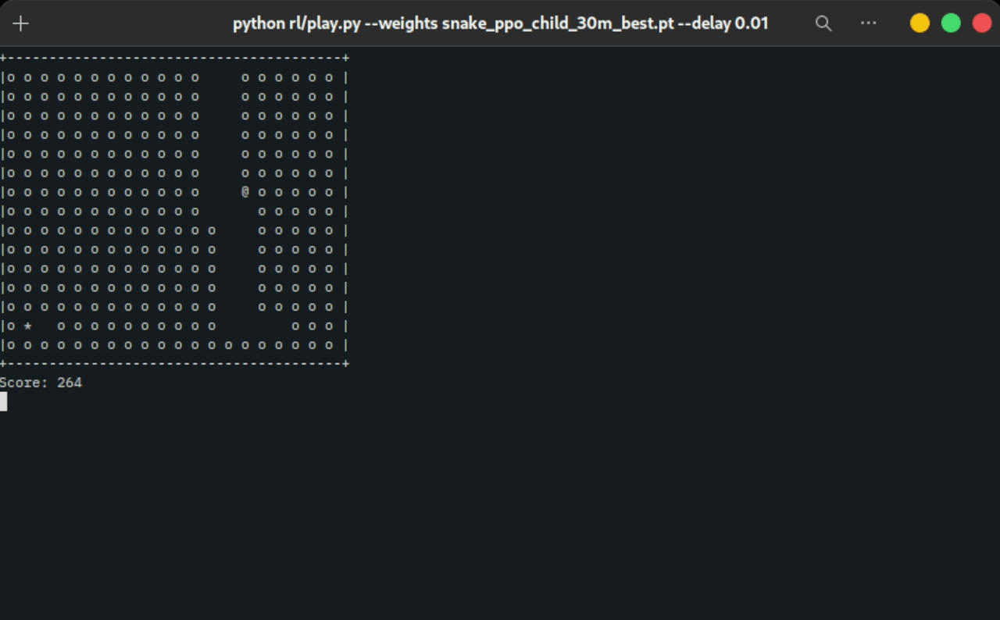

<div align="center">

  <h1>Snake RL</h1>

  <p>
    A Snake game engine in C++17, and a reinforcement learning agent that learned to fill the whole board
    from nothing but the screen, the arrow keys and the score.
  </p>

<p>
  <a href="https://github.com/Partha11/snake_rl_agent/stargazers">
    
  </a>
  <a href="https://github.com/Partha11/snake_rl_agent/issues/">
    
  </a>
  <a href="https://isocpp.org/">
    
  </a>
  <a href="https://cmake.org/">
    
  </a>
</p>

<h4>
  <a href="https://partha11.github.io/snake_rl_agent/">Documentation</a>
  <span> · </span>
  <a href="https://github.com/Partha11/snake_rl_agent/releases">Download</a>
  <span> · </span>
  <a href="https://github.com/Partha11/snake_rl_agent/issues/">Report Bug</a>
</h4>

<!--  -->

</div>

## About

Snake RL is two things in one repository:

- **A Snake game** with a fast C++17 engine and a terminal frontend that runs on Linux and Windows.
- **A reinforcement learning agent** that plays it. The engine is exposed to Python through pybind11, and a PPO agent trained on it sees only the board, chooses between the arrow keys and learns from the score. The trained agent fills the entire 20 &times; 15 board in about one game out of five.

The [documentation](https://partha11.github.io/snake_rl_agent/) covers the engine, the environment, the agent and the experiments behind it.

## Download and Play

Ready-to-run binaries for Linux and Windows are attached to every [release](https://github.com/Partha11/snake_rl_agent/releases):

```bash
# Linux
chmod +x snake-linux-x86_64
./snake-linux-x86_64

# Windows (Command Prompt or PowerShell)
snake-windows-x86_64.exe
```

Move with the arrow keys or WASD, quit with Q. Pressing the direction you came from keeps the snake going straight.

Building from source and the full game rules: [Playing the game](https://partha11.github.io/snake_rl_agent/game/playing/) · [Building from source](https://partha11.github.io/snake_rl_agent/game/building/)

## AI Setup

The agent needs Python 3.10+, the Python dependencies and the compiled engine module:

```bash
git clone https://github.com/Partha11/snake_rl_agent.git
cd snake_rl_agent

python3 -m venv .venv
source .venv/bin/activate        # Windows: .venv\Scripts\activate

pip install pip-tools
pip-compile requirements.in
pip install -r requirements.txt

cmake -S . -B build -DCMAKE_BUILD_TYPE=Release
cmake --build build --target snake_cpp
```

Download the trained weights (`snake_ppo_child_best.pt`) from the [releases](https://github.com/Partha11/snake_rl_agent/releases) page and watch the agent play:

```bash
python rl/play.py --weights snake_ppo_child_best.pt
```

PyTorch versions, GPU setup and troubleshooting: [AI setup](https://partha11.github.io/snake_rl_agent/agent/setup/)

## Training

Train an agent from scratch, then evaluate it over 200 games:

```bash
python rl/train.py --tag child --view fixed --replay-envs 8
python rl/diagnose.py --weights snake_ppo_child_best.pt --episodes 200
```

Training saves checkpoints as it goes and can be resumed with `--resume`. Every option, the reward rules and the results of each experiment: [Training](https://partha11.github.io/snake_rl_agent/agent/training/)

## Contributing

Contributions are welcome:

1. Fork the repository
2. Create a feature branch (`git checkout -b feature/my-feature`)
3. Commit your changes (`git commit -m 'Add my feature'`)
4. Push the branch (`git push origin feature/my-feature`)
5. Open a pull request

Bug reports and ideas go to [issues](https://github.com/Partha11/snake_rl_agent/issues). Guidelines: [Contributing](https://partha11.github.io/snake_rl_agent/contributing/)

## License

Distributed under the MIT License. See [LICENSE](LICENSE).